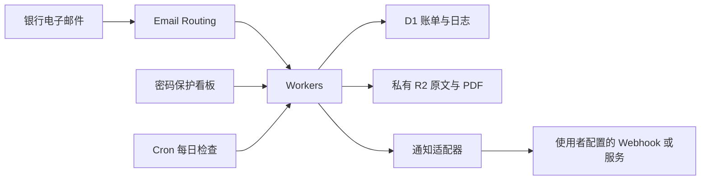

# Cloudflare Bill Manager

一个可自行部署的信用卡账单整理、周期账单管理和还款提醒系统。基于 **Cloudflare Workers + D1 + R2 + Email Routing + Cron Triggers**，使用 ES Module 和纯 JavaScript，无需自建后端服务器。

本仓库是通用开源版本，不包含预置用户、个人域名、真实账单、登录密码或通知凭据。**通知默认关闭**，部署者自行配置接收邮箱、数据库、对象存储及通知渠道。

## 功能说明

### 邮件账单整理

- 通过 Cloudflare Email Routing 接收银行账单，使用 `postal-mime` 解析 MIME 正文和附件。
- 支持识别招商、中信、广发、建设、工商、平安、交通、中行、农行、兴业、浦发、民生、光大等银行；不同银行模板的字段完整度可能不同。
- 提取人民币全额应还、最低还款额、账单日、还款日、客户姓名、银行卡后四位、可识别交易明细及年费相关信息。
- 支持双语标签、HTML 嵌套表格、分离的表头与金额行、千分位金额、遮罩卡号和多种日期格式。
- 不把信用额度、最低还款额、溢缴款或卡号前缀当成应还总额；不能确定的数据进入“待人工确认”。
- MIME 原文按 SHA-256 保存到私有 R2，支持重新解析及在网页导入 `.eml` 原始邮件。
- PDF 附件单独保存，登录后通过 Worker 代理查看。内容指纹相同且银行一致的 PDF 可复用已核对账单结果。
- 默认按“同银行、同还款日”去重；重复转发不累计金额。金额冲突进入待确认。

### 看板与还款记录

- 密码保护的暗色、响应式网页，适配手机和桌面。
- 展示本月待还、临期及逾期、当月已还统计。
- 显示客户姓名、卡尾号、总额、最低还款、账单日、还款倒计时及可识别明细。
- 年费及减免信息单独提示；识别到减免不代表新增年费。
- 支持标记已还及撤销，并记录带时间的还款操作日志。
- 零元账单显示“无需还款”，不参与催还提醒。
- 待确认记录可人工补录；重新解析显示进度、实际结果及失败原因。

### 房贷与其他周期账单

- 自行添加房贷、租金及其他固定周期账单。
- 可填写名称、机构、客户姓名、扣款卡后四位、每期金额、周期月数、还款日、起止日期。
- 周期 `1 / 3 / 12` 分别表示每月、每季度、每年。
- 设为 31 日时，短月份使用月末；之后仍按原设定日生成，避免日期逐月漂移。
- 自动生成未来 35 天内的应还账单，重复执行不会重复生成。
- 可修改每期金额：同步更新今天及以后尚未还款的周期账单，保留已还及历史到期金额，适合每年调整递减房贷金额。
- 可暂停、恢复生成；已有账单保留，恢复时会补齐暂停期间按配置应到期的账单。
- 按用户填写的金额记账，不计算摊还计划、浮动利率或提前还款，也不执行银行扣款。

### 每日提醒

- 默认每天 **北京时间 09:00** 检查，Cron 为 UTC `0 1 * * *`。
- 提醒距还款日**不足 3 天**的未还且金额大于零的账单：剩余 2 天、1 天、今日到期及逾期。刚好剩 3 天不提醒。
- 信用卡与周期账单统一汇总；每个通知渠道每天成功发送一条，未还账单次日继续提醒。
- 没有符合条件的账单、通知未启用时不发送。通知未启用也不会写入“已发送”。
- 使用 D1 日期与渠道唯一锁防止并发重复，成功后当天不重复推送；失败可重试。
- 长列表控制消息长度，保留总金额、优先到期项目和看板入口，避免自动分段。

## 架构



## 环境要求

- Node.js 24 与 npm。
- 自己的 Cloudflare 账号，能够使用 Workers、D1 和 R2。
- 接收邮件时，需要在 Cloudflare 管理的域名上配置 Email Routing；只用手动导入 `.eml` 或周期账单时，可先不配置邮件路由。
- 自己的通知接收服务，或自行实现通知适配器。

## 快速部署

### 1. 安装并创建本地配置

下载或克隆本仓库后：

```bash
npm ci
cp wrangler.toml wrangler.local.toml
cp .dev.vars.example .dev.vars
```

PowerShell 可将 `cp` 替换为 `Copy-Item`。

`wrangler.local.toml` 和 `.dev.vars` 都已被 Git 忽略。开发、数据库与部署命令优先使用 `wrangler.local.toml`；CI 构建只使用不含私人配置的 `wrangler.toml` 模板。

### 2. 创建 Cloudflare 资源

```bash
npx wrangler login
npx wrangler d1 create cloudflare-bill-manager
npx wrangler r2 bucket create cloudflare-bill-manager
```

将返回的 D1 数据库 ID 填入 `wrangler.local.toml`。如果修改资源名称，也要更新 `database_name` 和 `bucket_name`。

配置以下非敏感变量：

| 配置项 | 用途 |
|---|---|
| `name` | Worker 名称，也用于 Email Routing 目标 |
| `APP_URL` | 部署后自己的看板地址 |
| `EMAIL_RECIPIENT` | 自己配置的完整收件地址，例如 `statements@mail.example.com` |
| `NOTIFY_PROVIDER` | 默认 `none`；配置通知后改为 `webhook` 或自定义适配器名称 |
| `DB` | D1 绑定 |
| `BUCKET` | 私有 R2 绑定 |

模板的全零数据库 ID 和示例域名都必须替换。

### 3. 配置登录密钥

本地开发时编辑 `.dev.vars`，设置独立的 `AUTH_TOKEN` 与 `LOGIN_PASSWORD`。可用下面的命令生成随机值：

```bash
node -e "console.log(require('node:crypto').randomBytes(32).toString('hex'))"
```

生产环境通过 Secrets 保存，不要写进 TOML 或提交到仓库：

```bash
npx wrangler secret put AUTH_TOKEN --config wrangler.local.toml
npx wrangler secret put LOGIN_PASSWORD --config wrangler.local.toml
```

`AUTH_TOKEN` 用于 API 和会话签名，`LOGIN_PASSWORD` 用于网页登录。生产环境建议分别设置。更改密码后如需使已有会话全部失效，同时轮换 `AUTH_TOKEN`。

### 4. 初始化和启动

本地运行：

```bash
npm run db:local
npm run dev
```

首次远程部署：

```bash
npm run db:remote
npm run deploy
```

部署后，将自己的地址填入 `APP_URL` 并再次部署。默认使用自己的 `workers.dev` 地址；也可以在本地配置中启用自定义域名：

```toml
[[routes]]
pattern = "bills.example.com"
custom_domain = true
```

本仓库提供首次安装的完整 `schema.sql`。已有部署升级字段时需编写并执行相应 SQL 迁移；`CREATE TABLE IF NOT EXISTS` 不会自动更新旧表字段。

### 5. 配置邮件接收

在 Cloudflare Email Routing 中，为自己的收件地址添加精确规则，目标选择本项目 Worker。例如：

```text
statements@mail.example.com → cloudflare-bill-manager Worker
```

同步将 `EMAIL_RECIPIENT` 设置为该地址。可使用独立邮件子域，按 Cloudflare 提示配置 MX/SPF，避免替换已有邮箱的根域记录。

将银行账单转发到自己的地址；也可以从邮箱下载原始 `.eml`，登录看板后点击“导入 .eml 邮件”。首次接入每家银行时，先对照原始账单核对金额和日期。

配置参考：[Email Routing 子域](https://developers.cloudflare.com/email-service/configuration/subdomains/)、[邮件 Worker API](https://developers.cloudflare.com/email-service/api/route-emails/email-handler/)、[Cron Triggers](https://developers.cloudflare.com/workers/configuration/cron-triggers/)。

## 自由配置通知方式

### 默认不发送

```toml
[vars]
NOTIFY_PROVIDER = "none"
```

不会连接任何预置的私人中转服务。项目没有默认通知账号或接收人。

### 通用 Webhook

在 `wrangler.local.toml` 中设置：

```toml
[vars]
NOTIFY_PROVIDER = "webhook"
```

通过 Secrets 设置自己的地址和可选认证令牌：

```bash
npx wrangler secret put NOTIFY_WEBHOOK_URL --config wrangler.local.toml
npx wrangler secret put NOTIFY_WEBHOOK_TOKEN --config wrangler.local.toml
```

默认向该 HTTPS 地址发送：

```json
{
  "title": "通知标题",
  "body": "通知正文",
  "url": "自己的看板地址"
}
```

配置令牌后，会附带 `Authorization: Bearer ...`。可以将 JSON 格式的自定义请求头保存为 `NOTIFY_WEBHOOK_HEADERS` Secret。

如果目标服务需要不同 JSON 结构，可以将模板保存为 `NOTIFY_WEBHOOK_TEMPLATE` Secret。例如：

```json
{
  "type": "text",
  "text": { "content": "{{message}}" }
}
```

支持变量 `{{title}}`、`{{body}}`、`{{appUrl}}`、`{{message}}`，可在嵌套对象和数组的字符串值中使用。`message` 为标题、正文、看板地址的组合。模板先解析为 JSON，再替换字符串值，不执行表达式或代码。

Webhook 必须使用 HTTPS；不跟随重定向。默认将 HTTP 2xx 视为接收成功。如果目标平台还需判断业务状态码，请使用自定义适配器进行校验。

### 添加自己的适配器

每种渠道是一个普通异步函数，签名为：

```js
async function send({ env, title, body, appUrl })
```

成功时正常返回，失败时抛出异常。以下示例通过使用者自己部署的 Service Binding 发送通知：

```js
// src/notifications/my-service.js
export async function sendMyService({ env, title, body, appUrl }) {
  if (!env.NOTIFY_SERVICE) throw new Error('Missing NOTIFY_SERVICE binding');
  const response = await env.NOTIFY_SERVICE.fetch('https://notifications.internal/send', {
    method: 'POST',
    headers: { 'Content-Type': 'application/json' },
    body: JSON.stringify({ title, body, url: appUrl }),
    signal: AbortSignal.timeout(20000),
  });
  if (!response.ok) throw new Error(`Notification HTTP ${response.status}`);
  const result = await response.json();
  if (result.ok !== true) throw new Error('Notification service rejected the message');
}
```

在 `src/notifications/index.js` 中注册：

```js
import { sendWebhook } from './webhook.js';
import { sendMyService } from './my-service.js';

export const notificationProviders = Object.freeze({
  webhook: sendWebhook,
  my_service: sendMyService,
});
```

在本地 TOML 中设置 `NOTIFY_PROVIDER = "my_service"`，并为自己部署的通知 Worker 配置绑定：

```toml
[[services]]
binding = "NOTIFY_SERVICE"
service = "your-notification-worker"
```

也可以按相同接口实现微信、Telegram、Bark、邮件等适配器。所有凭据从 `env` 读取，使用 Wrangler Secrets 保存，不要硬编码。

配置后可通过已登录会话或 API 令牌调用 `POST /api/notifications/test` 进行真实发送测试。每日汇总使用日期锁，手动调用 `POST /api/reminders/run` 也受当天去重约束。

## 管理 API

除登录接口外，管理接口需要登录 Cookie，或 `Authorization: Bearer <AUTH_TOKEN>`。跨站 POST 会被拒绝，响应不缓存。

| 方法 | 路径 | 说明 |
|---|---|---|
| POST | `/api/login` | JSON `password`，建立签名会话 |
| POST | `/api/logout` | 退出当前会话 |
| GET | `/api/bills?status=all` | `all / unpaid / paid`，按还款日排序 |
| POST | `/api/bills/:id/pay` | 标记已还、记录日志 |
| POST | `/api/bills/:id/unpay` | 撤销已还、记录日志 |
| GET | `/api/bills/:id/logs` | 还款操作日志 |
| GET | `/api/bills/:id/pdf` | 鉴权代理 PDF，可通过 `attachment` 参数指定附件 |
| GET | `/api/attachments/:id` | 鉴权代理指定 PDF |
| GET | `/api/review` | 待人工确认邮件 |
| POST | `/api/review/:id/resolve` | 人工补录或更正账单 |
| POST | `/api/emails/:id/reprocess` | 重解析已保存原文；原文不存在返回 409 |
| POST | `/api/emails/import` | 导入原始 MIME 邮件，最大 20MB |
| GET / POST | `/api/recurring` | 获取、创建周期账单 |
| PATCH | `/api/recurring/:id` | 更新每期金额或启用状态 |
| POST | `/api/reminders/run` | 运行当天检查，返回汇总发送条数与账单数 |
| POST | `/api/notifications/test` | 测试自己配置的通知渠道 |

## PDF 文本扩展

默认保存 PDF，但不内置密码破解、OCR 或通用 PDF 解密器。正文提取不完整时进入人工确认。

已实现可选 `PDF_EXTRACTOR` Service Binding：接收 POST `/extract`，请求体为 PDF 二进制，返回 `{"text":"提取后的文本"}`。如果配置了 `PDF_PASSWORD` Secret，会通过 `X-PDF-Password` 传给该内部服务。超时 20 秒，文本最大 200 万字符；失败保留附件及待确认记录。

```toml
[[services]]
binding = "PDF_EXTRACTOR"
service = "your-pdf-extractor-worker"
```

只绑定自己信任的服务。项目没有预置外部 PDF 上传地址。

## 文件结构

```text
src/
  index.js                 email / fetch / scheduled 入口
  parser.js                字段与银行模板抽取
  html-tables.js           纯 JavaScript HTML 表格处理
  auth.js                  密码、签名 Cookie、API 鉴权及限流
  recurring.js             周期账单生成与 API
  reminders.js             每日汇总、长度限制与日期去重
  notify.js                通知统一入口
  notifications/           可扩展的通知适配器
  page.html                管理看板
  login.html               登录页
  recurring-ui.html        周期账单界面
scripts/
  wrangler.mjs             自动选择本地部署配置
  check-frontend.mjs        前端脚本语法检查
  check-public.mjs          常见凭据和私人数据文件检查
tests/                     合成样本及 D1/R2 集成测试
schema.sql                 首次安装数据库结构
wrangler.toml              通用配置模板
.dev.vars.example          本地 Secret 模板
.github/workflows/ci.yml    自动测试和构建
```

## 测试与贡献

```bash
npm test
npm run check
```

测试使用合成邮件和临时 Miniflare D1/R2，不需要真实账单或通知凭据，也不会向真实银行或通知服务发送消息。CI 使用通用配置进行 dry-run，不部署生产环境。

欢迎提交新的银行模板和通知适配器。请用虚构姓名、卡尾号、金额及 `example.com` 地址编写回归样本；不要在 Issue、PR、截图、附件或提交历史中放入真实银行邮件、完整卡号、个人联系方式、Cookie 或密钥。

## 数据与使用限制

- 本项目面向单个部署者，不是多人共享的账户权限系统。不同用户建议各自独立部署。
- 账单、客户姓名、卡尾号、交易明细保存在自己的 D1；邮件原文和 PDF 在自己的私有 R2。网页登录必须有密码，PDF 不使用公共桶地址。
- 登录 Cookie 为 Secure / HttpOnly / SameSite=Strict，有效期 12 小时；按来源 IP 做登录限流。`AUTH_TOKEN` 未配置时无法访问管理 API。
- Tailwind 使用 CDN，访问看板时需要能加载对应资源。
- 银行模板会变化，自动提取不是银行账户实时余额查询；某些邮件只含摘要或查询链接，没有可提取交易明细。
- 当前核心统计以人民币为主，不自动汇总外币，也不擅自推断缺失的账单日、卡尾号或客户姓名。
- 当前去重键是银行与还款日。同银行同日期的不同持卡人或多张独立账单，应人工使用不同银行标签，或扩展数据库去重键后再使用。
- 标记已还只是记录，不执行实际还款；还款操作日志也不是银行扣款凭证。
- 调整周期金额不会重写已还或历史到期金额。开始日期设在过去可能生成历史未还账单，请选择实际需要的首期日期。
- 每日成功推送后，当天新出现的符合条件账单会在次日检查中处理。外部服务已接收但响应丢失时，重试仍可能重复，不能保证跨服务严格一次。
- 通知发往使用者自行配置的渠道，接收服务将看到通知正文中的账单名称、金额与日期。默认关闭，由使用者决定接收目的地。
- `.gitignore` 与 `check-public` 是辅助保护，不代替人工审查；不要提交自己的配置和账单数据。

## 许可证

[MIT](LICENSE)。可自由使用、修改、分发和添加自己的通知方式。
